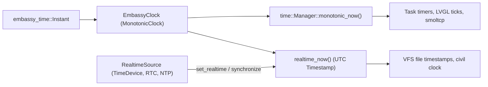

import CodeReference from "@/components/CodeReference.astro";
import Api from "@/components/Api.astro";

The time subsystem maintains monotonic elapsed time and adjustable UTC calendar time. It separates high-resolution interval measurements from civil clock adjustments. System timers therefore stay stable when real-time clocks are synchronized.

## Context

Operating systems need monotonic timers for timeouts, animation frames, and scheduling deadlines. These timers must never decrease or stall. Applications and filesystems also need UTC timestamps for civil calendar time.

The <Api path="time" /> isolates these two concerns. Real-time clock adjustments do not alter monotonic timers or disrupt network retransmissions and display loops.

## How it works

### Dual-clock architecture

The following diagram shows the dual-clock architecture of the time subsystem.

The <Api path="time::Manager" /> coordinates two distinct time representations:

1. **Monotonic elapsed clock**: measures elapsed duration since boot via the <Api path="time::MonotonicClock" /> trait.
2. **Realtime UTC calendar clock**: tracks civil time as a signed 128-bit integer representing nanoseconds since the Unix epoch.

### Monotonic clock and Embassy time

The default monotonic source is `EmbassyClock`, which reads hardware tick counters from Embassy's time driver. Each platform supplies the Embassy time driver. No Xila crate selects an Embassy `tick-hz` feature, so ticks use Embassy's default rate (`TICK_HZ`, 1 MHz).

Monotonic readings never decrease during a boot session. The subsystem uses this timebase for:

- Task sleep and timeout futures in the task manager.
- Display animation tick calculations in the graphics manager.
- Packet retransmission intervals and round-trip time calculations in smoltcp.

### UTC clock and synchronization

The manager calculates UTC time by applying a checked signed offset to the monotonic clock reading. It does not poll hardware clock peripherals on every read:

- **Initialization**: targets with a hardware real-time clock call `Manager::new` with an initial <Api path="time::RealtimeSource" />.
- **Unsynchronized boots**: targets without an initial time source call `Manager::unsynchronized()`, leaving monotonic time active while UTC reads return an error until synchronized.
- **Step adjustments**: calling `set_realtime` with a <Api path="time::RealtimeSample" /> applies time corrections immediately without gradual slew.
- **Subsystem effects**: the virtual file system applies UTC timestamps to created files if the clock is synchronized, while WebAssembly guest applications query monotonic or UTC clocks based on WASI clock subscriptions.

## Design choices and trade-offs

- **Derived UTC**: anchoring UTC to monotonic time allows fast in-memory timestamp reads protected by a brief critical section, avoiding bus contention with I2C/SPI real-time clocks.
- **Immediate step corrections**: Xila does not implement gradual frequency slewing in kernel space. Clock updates take effect instantly.
- **No timezone or DST logic**: timezone conversions, daylight saving time, and network time synchronization protocols are handled by user-space libraries.

## Limits

- Calling `realtime_now` on an unsynchronized manager returns an error until a valid realtime sample is supplied.
- Monotonic timestamps do not survive hardware resets. Every boot begins a new arbitrary monotonic epoch.

## API reference

- <Api path="time" /> - crate root and type aliases.
- <Api path="time::Manager" /> - main time subsystem manager.
- <Api path="time::Timestamp" /> - 128-bit nanosecond UTC timestamp.
- <Api path="time::MonotonicClock" /> - monotonic elapsed clock interface.
- <Api path="time::RealtimeSource" /> - hardware or network real-time clock
  source contract.
- <Api path="time::RealtimeSample" /> - real-time sample container.

## Related

- [Task](/explanation/architecture/subsystems/task/) - task timeouts and timer futures.
- [Virtual file system](/explanation/architecture/subsystems/virtual_file_system/) - file creation and modification timestamps.
- [Graphics](/explanation/architecture/subsystems/graphics/) - animation tick rate coordination.
