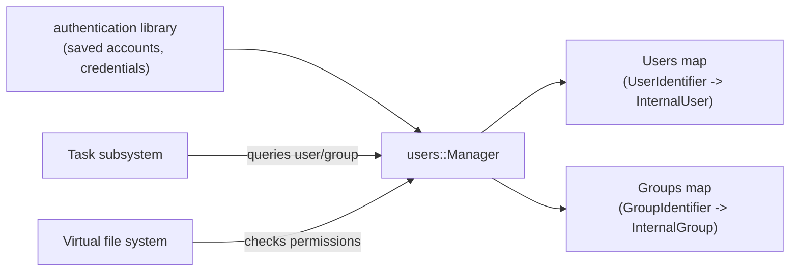

import CodeReference from "@/components/CodeReference.astro";
import HostReference from "@/components/HostReference.astro";

The users subsystem maintains in-memory registries of user and group identities. It allocates typed identifiers for tasks, tracks group memberships, and supplies credential metadata for virtual file system permission checks.

## Context

Multi-user security in Xila requires consistent user and group tracking across tasks and filesystems. The <HostReference crate="users" /> crate manages active account identifiers in memory.

This subsystem separates identity tracking from authentication mechanics. The `users` crate tracks runtime memberships and identifiers, while password hashing and on-disk account persistence are handled by the separate authentication library.

## How it works

### Identifiers and registries

The following diagram shows how the users manager connects accounts and groups to task and filesystem authorization.

The <HostReference crate="users" kind="struct" symbol="Manager" /> struct maintains two collections protected by an internal read-write lock:

- **Users**: maps each <HostReference crate="users" kind="struct" symbol="UserIdentifier" /> to a record holding the account username and its primary <HostReference crate="users" kind="struct" symbol="GroupIdentifier" />.
- **Groups**: maps each `GroupIdentifier` to a record containing the group name and a set of member user identifiers.

### Root identity and membership rules

Identifiers are 16-bit integer values:

- `UserIdentifier::ROOT` (value `0`) and `GroupIdentifier::ROOT` (value `0`) represent the system superuser account and root group.
- Standard user and group identifiers range from `1` (`MINIMUM`) to `65535` (`MAXIMUM`).
- Calling `add_to_group` associates a user with supplementary groups beyond their primary group.
- Calling `is_in_group` evaluates whether a given user holds membership in a target group.

### Integration with other subsystems

- **Task creation**: every task inherits the user and group identifier of the task that spawned it.
- **File permissions**: when opening files or modifying directories, the virtual file system queries `users::Manager` to compare the caller's identity against file ownership and permission bits.
- **Authentication boundary**: the authentication library populates user records into `users::Manager` during boot using saved account files.

## Design choices and trade-offs

- **In-memory lookup**: keeping user and group mappings in memory enables fast, allocation-free permission checks during high-frequency filesystem I/O.
- **Separation from authentication**: keeping authentication algorithms outside the kernel core prevents storage or cryptographic dependencies from leaking into basic identity resolution.
- **No static singletons**: the manager is instantiated explicitly by the platform and passed to subsystem contexts.

## Limits

- User records are stored in memory only. Commit changes to user accounts through the authentication library to persist them across reboots.

## API reference

- <HostReference crate="users" /> - crate root and type definitions.
- <HostReference crate="users" kind="struct" symbol="Manager" /> - main users
  subsystem manager.
- <HostReference crate="users" kind="struct" symbol="UserIdentifier" /> - typed
  16-bit user identifier.
- <HostReference crate="users" kind="struct" symbol="GroupIdentifier" /> - typed
  16-bit group identifier.

## Related

- [Virtual file system](/explanation/architecture/subsystems/virtual_file_system/) - permission verification on files and directories.
- [Task](/explanation/architecture/subsystems/task/) - task identity and user context inheritance.
- [Authentication](/explanation/architecture/libraries/authentication/) - user credential hashing and account persistence.
