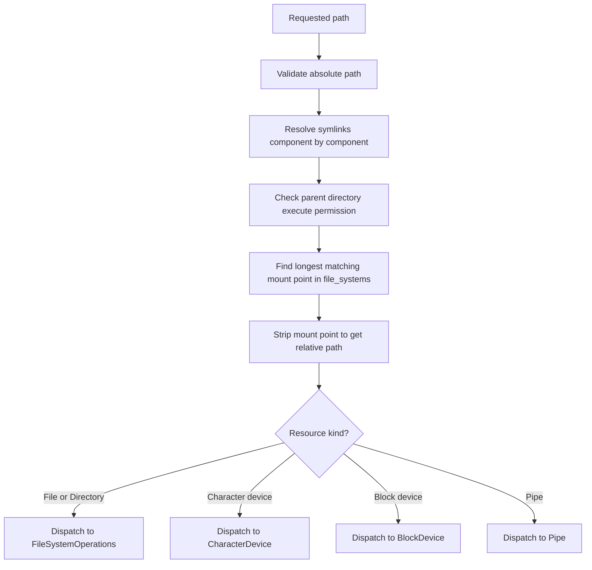
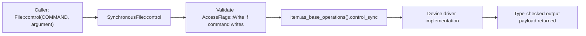

import CodeReference from "@/components/CodeReference.astro";
import Api from "@/components/Api.astro";

The virtual file system (VFS) gives every Xila component one unified path namespace for files, devices, and pipes. It resolves hierarchical paths, checks task permissions, and routes operations to mounted filesystems or device drivers.

## Context

Applications and system services interact with files, hardware peripherals, and inter-task communication through a single path namespace. The <Api path="virtual_file_system" /> provides standard file operations across all these resources, instead of separate APIs for storage blocks, UARTs, and network sockets.

The VFS manages path resolution, mounting tables, and access control policies. Concrete storage driver contracts and filesystem operations are defined separately by the [file_system](/explanation/architecture/libraries/file_system/) library.

## How it works

### Mount table and resource types

The <Api path="virtual_file_system::VirtualFileSystem" /> struct maintains mounted resources in synchronized tables:

- **Mounted filesystems**: an array of filesystems implementing `FileSystemOperations`, starting with the root filesystem at `/`.
- **Character devices**: a map of stream-oriented character devices mounted under `/devices/` (such as `/devices/time/clock` or `/devices/standard_io/output`).
- **Block devices**: a map of sector-oriented storage block devices.
- **Pipes**: unidirectional or bidirectional FIFO communication channels created via `File::create_unnamed_pipe`.

### Path resolution and mount lookup

The following flowchart illustrates how the virtual file system resolves a path and verifies access permissions.

When an application opens a path through <Api path="virtual_file_system::File" /> or <Api path="virtual_file_system::Directory" />:

1. The VFS validates that the path is non-empty, well-formed, and absolute.
2. Symbolic links are resolved component-by-component up to loop limits using `read_link_payload`.
3. The VFS identifies the caller task from the task manager and fetches its user and group identifiers.
4. It checks that the user holds execute permission on each directory along the path traversal.
5. The mount table is scanned to find the longest matching mount point prefix.
6. The prefix is stripped to produce a backend-relative path, which is forwarded to the mounted filesystem or device driver.

### Device control commands

The following diagram shows the control command execution flow from caller to concrete driver.

In addition to sequential byte reads and writes, devices support typed control commands:

1. A caller invokes `File::control` with a typed command identifier and input argument.
2. The VFS checks whether the command modifies device state (`ControlDirectionFlags::Write`). If so, it verifies that the file handle was opened with write access.
3. The command and arguments are converted into `AnyByLayout` pointer wrappers.
4. The VFS calls `control_sync` on the driver's `BaseOperations` implementation.
5. The driver writes results into the caller-provided output buffer.

### Permissions model

Every file and directory in the filesystem carries user, group, and other permission bits (`Permission::Read`, `Permission::Write`, `Permission::Execute`):

- The root user (`UserIdentifier::ROOT`) bypasses read and write permission checks.
- If the caller's user identifier matches the file's owner, user permissions apply.
- If the caller belongs to the file's owning group, group permissions apply.
- Otherwise, other permissions apply.

## Design choices and trade-offs

- **Unified namespace**: routing hardware devices and inter-task pipes through the filesystem path namespace allows standard redirection and unified permission checks.
- **Synchronous base operations**: drivers implement synchronous primitives (`control_sync`, `read_sync`, `write_sync`), while the VFS provides asynchronous wrappers with cooperative yielding.
- **Overlay protection**: unmounting paths that have active child mounts or open file descriptors is rejected unless explicitly forced.

## Limits

- Symbolic link target strings are limited to `MAX_SYMLINK_TARGET_LENGTH` (4,096 bytes).
- Removing an in-use mount point returns `Error::RessourceBusy` unless forced.

## API reference

- <Api path="virtual_file_system" /> - crate root and type definitions.
- <Api path="virtual_file_system::VirtualFileSystem" />- core VFS manager.
- <Api path="virtual_file_system::File" /> - asynchronous file handle.
- <Api path="virtual_file_system::Directory" />- asynchronous directory handle.
- <Api path="virtual_file_system::initialize" /> - initializes the VFS with a
  root filesystem.

## Related

- [File system](/explanation/architecture/libraries/file_system/) - core filesystem traits and block device contracts.
- [Task](/explanation/architecture/subsystems/task/) - task identity resolution for permissions.
- [Users](/explanation/architecture/subsystems/users/) - user and group identifier management.
- [Time](/explanation/architecture/subsystems/time/) - file creation and modification timestamps.
