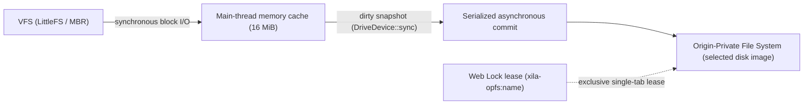

import CodeReference from "@/components/CodeReference.astro";
import HostReference from "@/components/HostReference.astro";

The browser runtime persists Xila storage inside the Origin-Private File System (OPFS). It bridges synchronous block device operations with asynchronous browser APIs using a memory cache and exclusive Web Locks leases.

## Context

Running an operating system inside a browser tab requires durable storage that survives page reloads. However, browser storage models differ fundamentally from physical storage hardware:

- Synchronous OPFS file access handles (`FileSystemSyncAccessHandle`) are restricted to Web Workers and cannot be accessed from the browser main thread.
- Xila's UI, event dispatch, and virtual file system execute on the main thread.
- Multiple browser tabs on the same origin could attempt to write to the same disk image simultaneously, leading to file system corruption.

The browser platform driver (`DriveDevice`) resolves these constraints by maintaining a disk-sized memory cache on the main thread and asynchronously committing snapshots to OPFS.

## How it works

### Memory cache and asynchronous synchronization

The following diagram illustrates how synchronous block operations interact with memory caching, serialization, and OPFS storage:

1. **Synchronous block access**: `DriveDevice` satisfies synchronous read and write operations directly from a 16 MiB in-memory `Uint8Array` cache. Each write increments an internal generation counter.
2. **Asynchronous commits**: calling `DriveDevice::sync().await` snapshots dirty data and writes it to the OPFS file handle.
3. **Autosave cadence**: the runtime commits snapshots on startup, once every second when the cache is marked dirty, and during normal shutdown.
4. **Write throttling during disk switch**: when switching disks, `stop_writes` rejects new writes (`Error::RessourceBusy`), the pending snapshot commits to OPFS, and the disk lock is released before reloading.

### Disk manager and Web Locks leases

Browser disks are managed through the **Xila Help** sidebar in `platforms/examples/wasm`:

- **Disk naming**: the default disk image is `xila_drive.img`. Newly created disks use date-based names such as `xila_YYYY-MM-DD.img` (with numerical suffixes like `_1.img` when multiple disks are created on the same day). The active selection is saved in `localStorage` under the key `xila.selectedDisk`.
- **Exclusive Web Locks**: before opening an OPFS file, the runtime requests an exclusive Web Lock named `xila-opfs:<name>`. This prevents two browser tabs from mounting the same disk concurrently. A tab holds its lease until closed or switched.
- **Reference seed download**: when opening an absent or empty disk file, the runtime downloads a prebuilt LittleFS image (`seed.img`) containing default applications and configuration via HTTP Fetch. Existing disks with stored files never download a seed image.

:::caution[Disk removal and origin clearing are permanent]
Deleting a disk removes its OPFS file handle immediately. Clearing browser site data or origin storage deletes all saved disk images and configuration for the origin.
:::

## Design choices and trade-offs

- **Main-thread memory caching**: caching the full 16 MiB image in RAM avoids offloading the entire VFS and UI pipeline to a Web Worker, ensuring predictable execution latency on the browser main thread.
- **Immutable existing disks on error**: if an existing disk image fails MBR verification or LittleFS mounting, boot halts with an error. The runtime never reformats or overwrites an existing image on mount failure.
- **Atomic snapshot replacement**: saves copy the dirty cache into a dedicated transfer buffer before writing to OPFS, ensuring writes during a save do not cause torn disk blocks.

## Limits

- Crashes, power loss, or abrupt tab closure can lose modifications made since the last successful 1-second autosave cycle.
- Background tab throttling imposed by web browsers may delay scheduled autosave timers.
- Storage quota is governed by the browser's eviction policies and available host disk space.

## API reference

- <HostReference crate="file_system" kind="trait" symbol="DirectBlockDevice" />—
  synchronous block device contract.
- <HostReference crate="little_fs" kind="fn" symbol="mount_disk" /> — safe disk
  mounting without reformatting.
- <CodeReference repo="platforms" path="drivers/wasm/src/devices/drive.rs" /> —
  browser OPFS drive device.
- <CodeReference repo="platforms" path="examples/wasm/src/storage.rs" /> —
  browser storage initialization.
- <CodeReference repo="platforms" path="examples/wasm/disk_manager.mjs" /> —
  disk management and Web Locks.

## Related

- [Manage browser disks](/how-to/reset-browser-storage/)
- [Little FS](/explanation/architecture/libraries/little_fs/)
- [File system](/explanation/architecture/libraries/file_system/)
- [Validate Xila changes](/how-to/validate-core/)
