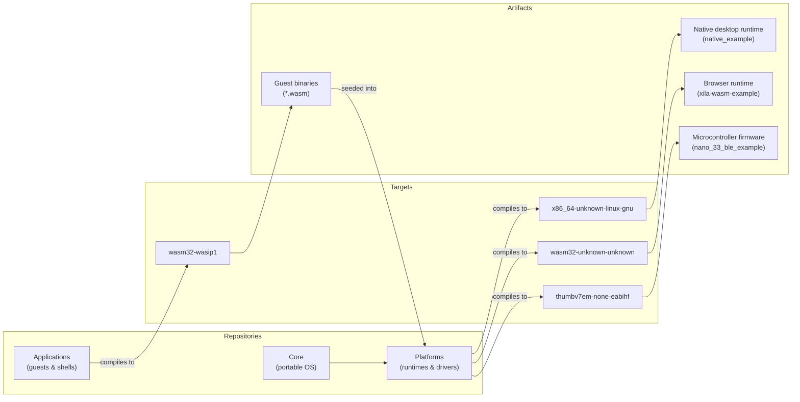

import CodeReference from "@/components/CodeReference.astro";
import Api from "@/components/Api.astro";

Xila spans multiple compilation targets and development environments across three main repositories. Core provides portable operating system logic. Applications implements guest applications and user-facing executables. Platforms produces concrete runtimes for desktop, browser, and microcontroller targets.

## Context

Operating systems for embedded and portable devices face conflicting requirements. Desktop workstations need rapid iteration, graphical debugging, and host testing. Web browsers need sandboxed WebAssembly execution and web storage integration. Microcontrollers need bare-metal real-time execution within tight RAM and flash budgets.

Xila addresses these demands by decoupling portable operating system subsystems from platform drivers and guest applications.

## How it works

### Repository responsibilities

The codebase is organized into three main repositories:

- **Core** (`github.com/xila-project/core`): Architecture-independent operating system subsystems and libraries. Owns the virtual file system (VFS), task management, memory allocation abstractions, authentication, graphics primitives, and device interfaces.
- **Applications** (`github.com/xila-project/applications`): User applications (such as Calculator, Clock, Weather, Pixel Painter, Text Editor, Synth, Digits, and Dashboard), system shells (graphical shell, command-line shell, terminal), and WebAssembly guest runtime bindings (`xila-wasm`).
- **Platforms** (`github.com/xila-project/platforms`): Concrete platform targets, platform drivers, reference disk image generation (`xila-fs-image`), and runtime binaries for desktop, browser, and microcontroller environments.

Supporting repositories include `package_manager` for application packaging and `registry` for signed package publication metadata.

### Execution targets

Xila compiles to these main Rust target triples:

| Target                     | Purpose                                 | Execution model                                           | Built by                           |
| -------------------------- | --------------------------------------- | --------------------------------------------------------- | ---------------------------------- |
| `x86_64-unknown-linux-gnu` | Native desktop runtime and host testing | Native machine code running on host Linux                 | Platforms (`examples/native`)      |
| `wasm32-wasip1`            | Sandboxed guest applications            | WebAssembly bytecode interpreted by Wasmi inside Xila     | Applications (`executables/*`)     |
| `wasm32-unknown-unknown`   | Browser runtime                         | WebAssembly bytecode executed directly by the web browser | Platforms (`examples/wasm`)        |
| `thumbv7em-none-eabihf`    | Embedded microcontroller firmware       | Bare-metal ARM Cortex-M4F machine code                    | Platforms (`examples/nano_33_ble`) |

The Espressif boards add more targets, built from the board crates in `examples/boards`: `xtensa-esp32-none-elf` (WT32-SC01), `xtensa-esp32s3-none-elf` (WT32-SC01 Plus, ESP32-S3 QEMU), `riscv32imac-unknown-none-elf` (ESP32-C6 QEMU) and `riscv32imafc-unknown-none-elf` (ESP32-P4 Function EV Board).

### Build and runtime flow

The following diagram shows which repository builds which runtime for which target architecture.

The build flow works as follows:

1. Core provides portable operating system logic as a library dependency to Applications and Platforms.
2. Applications compiles the guest applications to `wasm32-wasip1` WebAssembly binaries.
3. Platforms provisions those compiled guest binaries into reference LittleFS disk images using `xila-fs-image`.
4. Platforms compiles final runtime executables for host Linux (`x86_64-unknown-linux-gnu`), web browsers (`wasm32-unknown-unknown`), and the Arduino Nano 33 BLE (`thumbv7em-none-eabihf`).

## Design choices and trade-offs

- **Strict guest isolation via WASI Preview 1:** Guest applications run in isolated Wasmi instances compiled to `wasm32-wasip1`. Guests cannot inspect host memory or invoke arbitrary host syscalls. All interactions go through typed Xila device paths and application binary interface (ABI) calls.
- **`no_std` kernel core:** Core subsystems avoid dependencies on standard operating system libraries. The same VFS, task scheduler, and authentication logic therefore run on Linux, in browser WebAssembly, and on bare-metal ARM microcontrollers.
- **Cooperative scheduling for constrained targets:** desktop Linux can use preemptive threads. Browser and bare-metal targets use cooperative task execution with fuel-based limits and explicit yield points.
- **Build-time disk provisioning:** Application bundles and filesystem hierarchies are assembled at build time into reference disk images. This avoids heavy package installations or compilations on memory-limited microcontrollers.

## Limits

- **Microcontroller memory constraints:** The Arduino Nano 33 BLE provides 256 KiB of RAM and 1 MiB of internal flash. The graphical desktop and networking subsystems are disabled on this target to fit the budget.
- **Browser storage durability:** The browser runtime caches the disk image in memory and commits snapshots asynchronously to the Origin Private File System (OPFS). Abrupt tab closures can lose uncommitted modifications.
- **Espressif target status:** The Espressif driver source stays gated out on host targets, so host builds do not exercise it. Platforms CI builds the WT32-SC01, WT32-SC01 Plus and ESP32-P4 Function EV Board firmware, and boots the ESP32-S3 and ESP32-C6 images in Espressif's QEMU. The [supported hardware](/reference/supported-hardware/) reference lists which boards a maintainer tested.

## API reference

- <Api path="virtual_file_system" /> for the host virtual file system.
- <Api path="task" /> for the task management subsystem.
- <Api path="file_system" /> for file system traits and implementations.
- <Api api="guest" path="wasm" /> for the guest WebAssembly API.
- <CodeReference repo="platforms" path="examples/native/README.md" /> for the
  native runtime specification.
- <CodeReference repo="platforms" path="examples/nano_33_ble/README.md" /> for
  the Arduino Nano 33 BLE profile.

## Related

- [Set up a development environment](/how-to/setup-development/)
- [Run Xila natively](/tutorials/native/)
- [Run Calculator in the browser](/tutorials/browser/)
- [Run Xila on the Arduino Nano 33 BLE](/how-to/run-nano-33-ble/)
