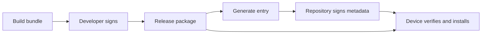
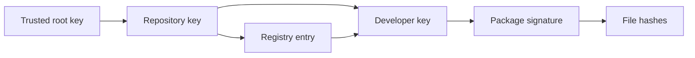

import CodeReference from "@/components/CodeReference.astro";

Package management connects signed application files to registry metadata and installation. The [package manager repository](https://github.com/xila-project/package_manager) owns the formats and tools; Applications owns the on-device installer.

## Context

A package (`.xpk` file) carries a manifest and payload. The [registry repository](https://github.com/xila-project/registry) holds metadata and developer keys; project releases host the packages themselves.

## How it works

The following diagram shows the publication and installation paths.

The desktop tool builds and signs a bundle, then makes a package. A registry entry is generated from that package. Registry publication signs the entry and developer key; the device obtains the package from its release URL.

The following diagram shows the trust chain for a repository install.

The root key authenticates repository keys. A repository key signs the entry and developer-key record. The entry identifies the authorized developer, archive digest and size. The developer key authenticates the manifest, which contains each file's SHA-256 digest. The installer checks the downloaded package and its payload against these records.

## Design choices and trade-offs

A repository install verifies signed root and index metadata, checks the entry and developer key, and checks the archive and manifest. The installer remembers accepted root and index versions, but does not check index expiry without a trustworthy clock. A local archive instead uses a directly trusted developer key; it does not authenticate registry metadata.

## Limits

The installer stages files before moving the verified bundle into place. It does not provide a durable transaction journal or verify signatures at launch. Protect installed files from unprivileged writes.

## API reference

- <CodeReference
    repo="applications"
    path="executables/package/src/repository.rs"
  >
    Repository installation
  </CodeReference>
  — metadata and archive checks.
- <CodeReference repo="applications" path="executables/package/src/install.rs">
    Local installation
  </CodeReference>
  — staging and verification.
- <CodeReference repo="package_manager" path="crates/manifest/src/trust.rs">
    Trust metadata
  </CodeReference>
  — root and index formats.

## Related

- [Experimental package format](/reference/package-format/)
- [Package](/explanation/architecture/executables/package/)
- [Publish a package](/how-to/publish-package/)
- [Submit a package](/how-to/submit-package/)
