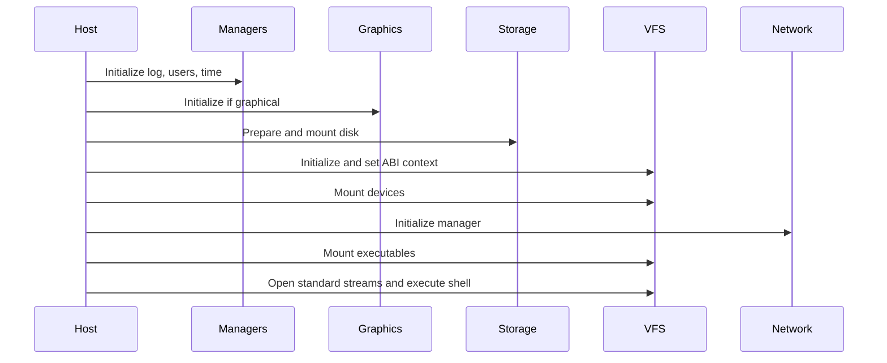

import CodeReference from "@/components/CodeReference.astro";
import HostReference from "@/components/HostReference.astro";

This guide shows how to compose a host runtime using the native example as a reference.

## Before you begin

- Set up the [development environment](/how-to/setup-development/) and inspect the <CodeReference repo="platforms" path="examples/native/src/main.rs">native example</CodeReference>.
- Choose drivers for your host and the Core `xila` features your runtime needs. The <CodeReference path="core/Cargo.toml">facade manifest</CodeReference> enables `network` and `abi_definitions` by default; graphics and other capabilities are feature gated.

## Steps

1. Create a task manager and initialize logging, users and time using host drivers. The native example provides a static <HostReference crate="task" kind="struct" symbol="Manager" /> and a time device.
2. If using graphics, initialize graphics with a screen and input devices and start its loop as a task.
3. Prepare and mount storage, then initialize the virtual file system with the task, users and time managers. Initialize the ABI context with the virtual file system and time manager.
4. Mount the devices and initialize the network manager and application context required by your host. Follow the native example for authentication and executable registration.
5. Mount the executables with <HostReference crate="executable" kind="macro" symbol="mount_executables" />, open the standard streams with <HostReference crate="executable" kind="struct" symbol="Standard" /> and start the first executable, such as the shell, with <HostReference crate="executable" kind="fn" symbol="execute" />.

The following diagram shows the order in the native example.

The host initializes managers before optional graphics, then mounts storage and initializes the virtual file system (VFS). It then mounts devices, initializes networking, mounts the executables under `/applications/executables/`, opens the standard streams and executes the shell.

## Verify the result

Build and run your host with the drivers and features you selected. The native example logs `Virtual file system initialized.` after VFS initialization.

## Related

- [Development commands](/reference/development-commands/)
