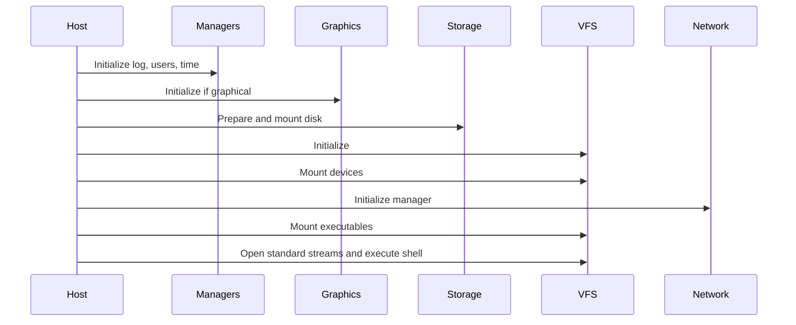

import CodeReference from "@/components/CodeReference.astro";
import Api from "@/components/Api.astro";

This guide shows how to compose a host runtime. It uses the native example as a reference.

## Before you begin

- Set up the [development environment](/how-to/setup-development/) and inspect the <CodeReference repo="platforms" path="examples/native/src/main.rs">native example</CodeReference>.
- Choose the drivers for your host and the Core `xila` features that your runtime needs. The <CodeReference path="core/Cargo.toml">facade manifest</CodeReference> enables `network` by default. Enable other Cargo features, for example `graphics`, when needed.

## Steps

1. Create a task manager and initialize logging, users and time using host drivers. The native example provides a static <Api path="task::Manager" /> and a time device.
2. If using graphics, initialize graphics with a screen and input devices and start its loop as a task.
3. Prepare and mount storage, then initialize the virtual file system with the task, users and time managers.
4. Mount the devices and initialize the network manager and the <Api path="executable::ExecutableContext" /> that your host requires. Follow the native example for authentication and executable registration.
5. Mount the executables with <Api path="executable::mount_executables" />, open the standard streams with <Api path="executable::Standard" /> and start the first executable, for example the shell, with <Api path="executable::execute" />.

The following diagram shows the order in the native example.

The host initializes the managers first, then optional graphics. It mounts storage and initializes the virtual file system (VFS). It then mounts the devices, initializes the network manager, mounts the executables under `/applications/executables/`, opens the standard streams and executes the shell.

## Verify the result

Build and run your host with the drivers and features you selected. The native example logs `Virtual file system initialized.` after VFS initialization.

## Related

- [Development commands](/reference/development-commands/)
