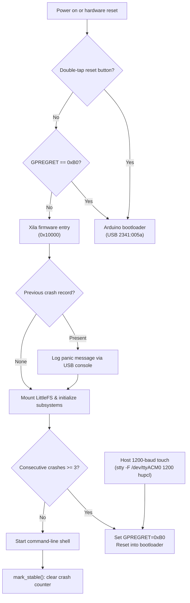

This guide shows how to compile Xila for the Arduino Nano 33 BLE, flash the firmware through the Arduino bootloader, log in through the USB serial console, control GPIO pins, and use hardware recovery modes.

## Before you begin

- An Arduino Nano 33 BLE board (Nordic Semiconductor nRF52840 SoC, 1 MiB internal flash, 256 KiB RAM) and a micro-USB cable.
- An x86_64 Linux development system with [mise](https://mise.jdx.dev/) and Git.
- Flashing tools: the Arduino fork of `bossac` (version 1.9.1-arduino2, supplied automatically by mise) and an ARM-compatible binary copy utility (`rust-objcopy`, `llvm-objcopy`, or `arm-none-eabi-objcopy`).
- Host serial permissions: write access to `/dev/ttyACM*` (such as membership in the `dialout` or `uucp` group on Linux).

:::caution
Flashing writes only to the firmware flash region (`0x10000`–`0x80000`) and preserves the file system. Erasing the storage flash pages (`0x80000`–`0x100000`) permanently deletes all saved user accounts, configurations, and data.
:::

## Steps

### Understand the memory layout

The board partitions the 1 MiB internal flash and 256 KiB RAM into fixed regions:

| Region      | Flash address range | Size    | Description                                        |
| ----------- | ------------------- | ------- | -------------------------------------------------- |
| Bootloader  | `0x00000`–`0x0FFFF` | 64 KiB  | Arduino USB bootloader (never overwritten by Xila) |
| Firmware    | `0x10000`–`0x7FFFF` | 448 KiB | Xila embedded runtime binary                       |
| File system | `0x80000`–`0xFFFFF` | 512 KiB | LittleFS root file system (4 KiB page size)        |

RAM is organized from `0x20000000` into static data, the dynamic heap, a 32 KiB stack, and a dedicated 256-byte uninitialized crash record at the top of memory (`0x2003FF00`–`0x2003FFFF`).

### Build the firmware

1. In the Platforms repository root, compile the embedded runtime:

```sh
mise run build:nano-33-ble
```

Cargo compiles `xila-nano-33-ble-example` for the `thumbv7em-none-eabihf` target with the `release-embedded` profile. The generated ELF binary is located at `target/thumbv7em-none-eabihf/release-embedded/nano_33_ble_example`.

Optional: To compile with the `bring-up` feature (which waits for a host terminal before running and automatically resets into the bootloader if no host connects within 60 seconds):

```sh
cargo build --locked -p xila-nano-33-ble-example --target thumbv7em-none-eabihf --profile release-embedded --features bring-up
```

### Flash through the bootloader

1. Connect the Arduino Nano 33 BLE to your computer using a micro-USB cable.
2. In the Platforms repository root, run the flashing task:

```sh
mise run flash:nano-33-ble
```

The flashing script (`examples/nano_33_ble/flash.sh`):

- Converts the ELF executable into a raw binary image using `objcopy`.
- Sends a 1200-baud touch (`stty -F /dev/ttyACM0 1200 hupcl`) to reboot the board into the Arduino bootloader.
- Waits for the bootloader USB device (`2341:005a`) to appear.
- Executes `bossac` to write and verify the firmware starting at offset `0x10000`.
- Resets the microcontroller into the newly flashed firmware.

If the board fails to enter the bootloader automatically, double-tap the physical reset button on the board (the onboard orange LED pulses) and run the command again.

### Connect to the serial console and log in

1. Open a serial terminal connected to the board:

```sh
picocom /dev/ttyACM0
```

Because the connection uses native USB CDC-ACM emulation, the host baud rate setting does not affect transmission speed.

2. On first startup, the firmware detects an unformatted flash region, formats the LittleFS file system, and seeds default accounts. The terminal displays:

```text
Xila on Arduino Nano 33 BLE
File system ready (formatted: true); heap: 184320 bytes used, 77824 free
```

3. When prompted for login, enter `administrator`.
4. Press `Enter` when prompted for a password (the initial password is blank).

The command-line shell starts:

```text
/ #
```

### Control GPIO pins

Board header pins and onboard LEDs are mounted as character devices under `/devices/gpio/`:

- Header digital pins: `/devices/gpio/d0` through `/devices/gpio/d13`
- Header analog pins: `/devices/gpio/a0` through `/devices/gpio/a7`
- Onboard yellow LED: `/devices/gpio/d13` (active-high, initially off)
- Onboard RGB LEDs: `/devices/gpio/led_red`, `/devices/gpio/led_green`, `/devices/gpio/led_blue` (active-low, initially off)

1. Read a pin state by reading the device file:

```text
cat /devices/gpio/d13
```

The device outputs `0` or `1` followed by a newline.

2. Write to a pin to update its output level:

```text
# Turn on the yellow LED:
echo 1 > /devices/gpio/d13

# Turn off the yellow LED:
echo 0 > /devices/gpio/d13
```

For the active-low RGB LEDs, writing `0` turns the LED on, and writing `1` turns it off:

```text
# Turn on the red LED:
echo 0 > /devices/gpio/led_red

# Turn off the red LED:
echo 1 > /devices/gpio/led_red
```

Writing any character other than `0` or `1` (surrounded by optional whitespace) returns an error. Internal power-enable lines (sensor power rails and I2C pull-ups) remain reserved and cannot be altered through GPIO devices.

### Recover the board

The following diagram shows the bootloader entry, crash detection, and recovery paths for the Arduino Nano 33 BLE.



The recovery mechanisms operate as follows:

- **1200-baud touch:** Host flashing scripts open the serial port at 1200 baud and close it. The USB console driver detects this request, sets `0xB0` in the `NRF_POWER->GPREGRET` register, and triggers a system reset into the Arduino bootloader.
- **Double-tap reset:** Pressing the physical reset button twice within 500 milliseconds instructs the hardware bootloader to remain active.
- **Panic preservation:** When a panic or hard fault occurs, `board::crash()` writes up to 248 bytes of the error message into the uninitialized RAM crash record and increments `GPREGRET2`. The subsequent boot reads and logs this message through the USB console.
- **Three-panic bootloader latch:** If three consecutive crashes occur before the system reaches `mark_stable()`, the firmware resets into the bootloader to prevent an unrecoverable restart loop.
- **Bring-up timeout:** When built with `--features bring-up`, hardware timer `TIMER1` counts down 60 seconds. If no host terminal opens the serial port within this period, the board automatically resets into the bootloader.

## Verify the result

1. In the serial terminal, verify that the shell prompt `/ #` appears after logging in.
2. Run `echo 1 > /devices/gpio/d13` and observe that the yellow onboard LED lights up.
3. Run `echo 0 > /devices/gpio/d13` and observe that the yellow LED turns off.

## Troubleshooting

| Symptom                                      | Cause                                     | Fix                                                                                                                                     |
| -------------------------------------------- | ----------------------------------------- | --------------------------------------------------------------------------------------------------------------------------------------- |
| Serial device `/dev/ttyACM0` does not appear | Firmware halted or USB disconnected       | Double-tap the physical reset button to force the Arduino bootloader mode (`2341:005a` in `lsusb`).                                     |
| Flashing fails with missing objcopy          | ARM binary utilities not installed        | Install `cargo-binutils` via `cargo install cargo-binutils && rustup component add llvm-tools`, or install system LLVM.                 |
| Board continuously resets                    | Panic loop during startup                 | Connect a serial terminal to read the panic message logged on boot. After three consecutive crashes, the board halts in the bootloader. |
| LittleFS fails to mount                      | Flash corruption in the storage partition | Erase the storage partition (`0x80000`–`0x100000`) through the bootloader or reflash with a full chip erase.                            |

## Related

- [Development environments and targets](/explanation/development-environments/)
- [Set up a development environment](/how-to/setup-development/)
- [Shell commands](/reference/shell/)
